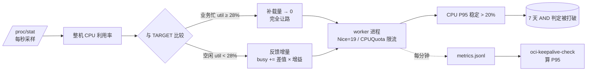

<div align="center">

# oci-keepalive

**让 Oracle Cloud Always Free 实例不再被判定为「闲置」，同时不打扰你的真实业务。**

[](LICENSE)
[](https://www.python.org/)
[](https://systemd.io/)
[](https://www.oracle.com/cloud/free/)
[](CONTRIBUTING.md)

[English](README.en.md) · [快速开始](#-快速开始) · [工作原理](#-工作原理) · [常见问题](#-常见问题)

</div>

---

## 这个项目解决什么

Oracle Cloud 的 Always Free 实例长期空着会被回收。很多人于是跑 `stress`、`dd`、定时死循环把 CPU 打满，或者干脆挂个挖矿脚本——**要么拖慢自己的网站，要么踩服务条款，要么根本不知道到底达标没有**。

`oci-keepalive` 换了个思路：

> **只在 CPU 闲着的时候补一点负载，业务一忙立刻归零。** 并且把 Oracle 自己用来判定的那个指标（7 天 CPU P95）直接算给你看。

- 不是破解、不是绕过计费、不联网、不挖矿、不改防火墙
- 一个 Python 脚本 + 一个 systemd unit，约 10 MB 内存
- 一键安装、开机自启、一键卸载
- 自带 **7 天 P95 自检**，达标与否有数据可查，不靠玄学

---

## 目录

- [官方规则到底是什么](#-官方规则到底是什么)
- [为什么不用常见方案](#-为什么不用常见方案)
- [特性](#-特性)
- [快速开始](#-快速开始)
- [工作原理](#-工作原理)
- [7 天自检：证明你真的达标](#-7-天自检证明你真的达标)
- [配置](#-配置)
- [命令参考：暂停 / 关闭 / 卸载](#-命令参考暂停--关闭--卸载)
- [常见问题](#-常见问题)
- [项目结构](#-项目结构)
- [兼容性与路线图](#-兼容性与路线图)
- [贡献 & License](#-贡献--license)

---

## 官方规则到底是什么

Oracle 官方文档 [*Always Free Resources → Reclamation of Idle Compute Instances*](https://docs.oracle.com/en-us/iaas/Content/FreeTier/freetier_topic-Always_Free_Resources.htm) 的原文是：

> Idle Always Free compute instances **may** be reclaimed by Oracle. Oracle will deem virtual machine and bare metal compute instances as idle if, during a **7-day period**, the following are true:
> - CPU utilization for the **95th percentile** is less than **20%**
> - Network utilization is less than **20%**
> - Memory utilization is less than **20%** *(applies to A1 shapes only)*

三个要点，网上 90% 的教程都搞错了：

| 要点 | 说明 |
|---|---|
| **是 AND 不是 OR** | `the following are true` = 三项**同时**成立才算闲置。**只要打破任意一项就安全** |
| **CPU 看的是 95 分位** | 不是平均值。7 天里只要 CPU 有超过 5% 的时间高于 20%，P95 就会越过阈值 |
| **阈值是 20%** | 网上流传的 10% / 15% 是旧版口径（截至 2026-11 核对官方文档） |

所以最省事、对业务影响最小的做法就是：**让 CPU P95 稳定站在 20% 以上**。不用去硬造网络流量（20% 带宽利用率几乎不可能靠小流量凑出来），也不用白占 1 GB+ 内存。

> ⚠️ 官方用的是 `may be reclaimed`，文档未说明回收是停机还是终止、是否提前发邮件。政策也可能调整，请以官方文档和你控制台的实际通知为准。

---

## 为什么不用常见方案

| 方案 | CPU 占用 | 业务影响 | 能否验证达标 | 风险 |
|---|---|---|---|---|
| `stress --cpu N` 常驻打满 | 100% | 严重，网站明显变卡 | 无 | 易被判滥用 |
| 定时 `dd` / `yes` 脉冲 | 间歇 100% | 任务窗口内卡顿 | 无 | 窗口外可能掉线 |
| 挂挖矿 / 挂机脚本 | 100% | 严重 | 无 | 违反服务条款 |
| 宝塔计划任务跑死循环 | 不可控 | 依赖面板，面板挂了就失效 | 无 | 不好调参 |
| **`oci-keepalive`（本项目）** | **默认 28% 地板** | **业务忙时自动归零** | **自带 7 天 P95 自检** | **纯本地整数运算** |

---

## 特性

- ✅ **自适应反馈控制**：每秒读 `/proc/stat` 算整机 CPU 利用率，动态决定补多少；业务占用越高，补得越少
- ✅ **三重隔离**：`Nice=19` + `CPUWeight=1` + `CPUQuota` 硬上限，业务永远优先；另有 `MemoryMax=64M`
- ✅ **多核自动适配**：worker 数按 CPU 亲和性自动取，安装脚本按核数计算 `CPUQuota`，升配不用手改
- ✅ **7 天 P95 自检**：`oci-keepalive-check` 直接告诉你是「安全」还是「危险」，支持 `--json`
- ✅ **配置与代码分离**：改参数只编辑 `/etc/oci-keepalive.conf`，不动 unit
- ✅ **单例锁**：重复启动不会造成双倍占用
- ✅ **额外保护**：可选 `KEEPALIVE_MAX_LOAD`，负载过高时暂停补载，照顾 I/O 密集型业务
- ✅ **零依赖**：只用 Python 标准库 + systemd，不装包、不联网、不写 crontab
- ✅ **幂等安装 / 一键卸载**：重复运行是升级，且会保留你改过的配置

---

## 快速开始

### 一键安装

```bash
curl -fsSL https://raw.githubusercontent.com/mkmkgo/oci-always-free-keepalive/main/install.sh | sudo bash
```

要求：`systemd` + `Python >= 3.8` + root。安装脚本会检查环境、按 CPU 核数算 `CPUQuota`、生成配置、启用并启动服务、设置开机自启。

本地已经 clone 了仓库的话，也可以：

```bash
sudo bash install.sh
```

### 确认在跑

```bash
sudo systemctl status oci-keepalive      # active (running) + enabled
sudo journalctl -u oci-keepalive -f      # 实时看 cpu= / fill=
oci-keepalive-check                      # 7 天 P95 自检
```

首次安装后等约 1 分钟，自检就有第一条采样了。

### 实测效果

在 A1 Flex（1 OCPU / 6 GB，Ubuntu 24.04）上，宝塔正在编译 PHP 8.2：

| 场景 | 业务 CPU | 服务日志 | 保活进程 CPU |
|---|---|---|---|
| 编译占满单核 | ~94% | `cpu=100.0% fill=0.0% target=28%` | **1.9%**（几乎完全让路） |
| 临时把目标拉到 150% | — | `fill 0% → 60% → 90%(上限)` | 补载链路确认可用 |
| 业务空闲（预期） | ~0% | `cpu≈28% fill≈28%` | 补齐到 28% |

---

## 工作原理



控制器是一个简单的积分反馈：

```
busy = clamp( busy + (TARGET - util) × PERIOD × GAIN , 0 , PERIOD × CAP )
```

- `util` 高于目标（业务忙）→ `busy` 每周期衰减，很快到 **0**
- `util` 低于目标（空闲）→ `busy` 增加，直到整机利用率收敛到 `TARGET`
- worker 用纯整数运算消耗时间片，**不分配大内存、不产生磁盘/网络 I/O**

再加上 systemd 的三层兜底，就算控制器出 bug 也伤不到业务：

| 层 | 设置 | 作用 |
|---|---|---|
| 调度优先级 | `Nice=19`、`CPUWeight=1` | 任何业务进程都能立刻抢走 CPU |
| 硬上限 | `CPUQuota`（安装时按核数算） | 保活最多只能吃到配额 |
| 资源隔离 | `MemoryMax=64M`、`IOSchedulingClass=idle` | 内存/磁盘不会失控 |

---

## 7 天自检：证明你真的达标

保活最怕的是「感觉应该没事」。所以服务每分钟往 `/var/lib/oci-keepalive/metrics.jsonl` 记一条采样，自动只保留最近 7 天，`check.py` 直接算 Oracle 用的那个指标：

```text
==============================================================
  oci-keepalive  |  Oracle Always Free idle-risk self check
==============================================================
  service          active / enabled
  metrics          10080 sample(s), 7.00 day(s) covered, file /var/lib/oci-keepalive/metrics.jsonl
  monitoring       running (OCI console CPU metrics)
  target CPU       28.0%   |   official idle line 20% (7-day P95)
--------------------------------------------------------------
  CPU P95          28.4%   (above 20% threshold)
  CPU average      27.9%
  fill average     22.1%   (rest is your real workload)
--------------------------------------------------------------
  [OK]   CPU P95 >= 20%: the 7-day idle condition is broken.
==============================================================
```

也支持机器可读输出，方便接监控：

```bash
oci-keepalive-check --json
oci-keepalive-check --strict   # 未达标退出 1，无数据退出 2
```

自检还会提示 **OCI 监控代理**是否在运行。代理没起来时控制台可能看不到 CPU 曲线，指标就无从核对了。

---

## 配置

编辑 `/etc/oci-keepalive.conf`，然后 `sudo systemctl restart oci-keepalive`。

| 变量 | 默认值 | 说明 |
|---|---|---|
| `KEEPALIVE_TARGET` | `0.28` | 目标整机 CPU 利用率。官方线 20%，建议 0.25–0.30 留余量 |
| `KEEPALIVE_PERIOD` | `1.0` | 控制周期（秒） |
| `KEEPALIVE_CAP` | `0.90` | 单周期最多用多少比例烧 CPU |
| `KEEPALIVE_GAIN` | `0.6` | 反馈增益，越大响应越快，过大易震荡 |
| `KEEPALIVE_LOG_EVERY` | `60` | 状态日志间隔（秒），0 = 关闭 |
| `KEEPALIVE_METRICS_EVERY` | `60` | 采样间隔（秒），0 = 关闭自检数据 |
| `KEEPALIVE_METRICS_FILE` | `/var/lib/oci-keepalive/metrics.jsonl` | 采样文件 |
| `KEEPALIVE_MAX_LOAD` | `0` | 1 分钟 load 超过该值就暂停补载，0 = 关闭 |

> 想更保守就用 `KEEPALIVE_TARGET=0.23`；想更保险就用 `0.30`。只要 P95 稳定高于 20% 即可。

---

## 命令参考：暂停 / 关闭 / 卸载

三种「不想要了」的力度，按需选：

| 目的 | 命令 | 重启后 |
|---|---|---|
| **临时暂停**（保留开机自启） | `sudo systemctl stop oci-keepalive` | 会再自动启动 |
| **彻底关闭但保留文件** | `sudo systemctl disable --now oci-keepalive` | 不再启动，配置与采样都还在 |
| **恢复** | `sudo systemctl enable --now oci-keepalive` | 正常自启 |
| **一键卸载** | `curl -fsSL https://raw.githubusercontent.com/mkmkgo/oci-always-free-keepalive/main/uninstall.sh \| sudo bash` | 服务与脚本全删，默认保留配置和采样 |
| **卸载并清空数据** | `curl -fsSL .../uninstall.sh \| sudo bash -s -- --purge` | 连 `/etc/oci-keepalive.conf` 和采样一起删 |

手动卸载（等价）：

```bash
sudo systemctl disable --now oci-keepalive
sudo rm -f /etc/systemd/system/oci-keepalive.service
sudo rm -rf /opt/oci-keepalive /usr/local/bin/oci-keepalive-check
sudo systemctl daemon-reload
```

常用运维：

```bash
sudo systemctl status oci-keepalive
sudo journalctl -u oci-keepalive -n 30 --no-pager
oci-keepalive-check --json
sudo bash /path/to/repo/install.sh          # 幂等升级，保留你的配置
```

---

## 常见问题

<details>
<summary><b>会不会拖慢我的网站 / 数据库？</b></summary>

设计目标就是不影响。业务进程一旦开始用 CPU，测得的整体利用率高于目标，补载量会在几个周期内衰减到 0；就算还没衰减完，`Nice=19` + `CPUWeight=1` 也让业务优先，`CPUQuota` 还给了硬上限。上面的实测表里，编译占 94% 时保活只用了 1.9%。

如果业务是 I/O 密集（load 高但 CPU 不高），可以设 `KEEPALIVE_MAX_LOAD` 再加一道保险。
</details>

<details>
<summary><b>这样算不算违规 / 会不会被判滥用？</b></summary>

官方规则只描述资源利用率，未禁止保持资源活跃；本项目不联网、不挖矿、不伪造监控数据、不修改系统网络配置，只是让 CPU 做无意义的整数运算。但政策由 Oracle 解释且可能变化，请自行核对最新条款。

另一个更省心的路子是升级成 **Pay As You Go**（免费额度内仍不收费），社区普遍反馈升级后不再走闲置回收；但 Oracle 官方文档**没有明文写豁免**，且超额度会真实计费，本项目不替你做这个决定。
</details>

<details>
<summary><b>为什么只补 CPU，不补内存和网络？</b></summary>

因为三个条件是 AND。只要 CPU P95 不低于 20%，「三项同时成立」就不可能满足。硬造 20% 带宽利用率成本极高，白占 1 GB+ 内存又纯属浪费。
</details>

<details>
<summary><b>怎么确认 Oracle 那边真的看到了？</b></summary>

OCI 控制台 → Compute → Instances → 你的实例 → **Metrics → CPU Utilization**，看 7 天曲线。`oci-keepalive-check` 里的 `monitoring` 一行会告诉你监控代理是否在跑；代理没起来时控制台可能没有曲线。
</details>

<details>
<summary><b>升配到 2 / 4 OCPU 后要改什么？</b></summary>

什么都不用改，重新跑一次 `install.sh` 即可：worker 数按 `os.sched_getaffinity()` 自动取，`CPUQuota` 也会按新核数重新计算。只有当你手改过 unit 时才需要留意 `CPUQuota` 是否够用。
</details>

<details>
<summary><b>非 systemd 的系统能用吗？</b></summary>

目前只支持 systemd（Ubuntu / Debian / Oracle Linux / Rocky 等）。脚本本身可以 `python3 keepalive.py` 直接跑，但会失去开机自启、优先级和资源限制，不推荐生产使用。
</details>

<details>
<summary><b>采样文件会不会一直变大？</b></summary>

不会。每分钟 1 条、约 10080 条/7 天，服务每天清理一次，只保留滚动 7 天窗口，且最多 11000 行（约 1 MB）。
</details>

---

## 项目结构

```
oci-always-free-keepalive/
├── keepalive.py                  # 自适应控制器 + CPU worker
├── check.py                      # 7 天 P95 自检（也装成 oci-keepalive-check）
├── oci-keepalive.service         # systemd unit 模板
├── oci-keepalive.conf.example    # 配置样例
├── install.sh                    # 幂等一键安装
├── uninstall.sh                  # 一键卸载（--purge 清数据）
├── README.md                     # 中文文档
├── README.en.md                  # English docs
├── CONTRIBUTING.md
├── CHANGELOG.md
├── LICENSE                       # MIT
└── .github/workflows/ci.yml      # py_compile + bash -n + shellcheck
```

---

## 兼容性与路线图

| 项 | 状态 |
|---|---|
| Ubuntu 22.04 / 24.04 (ARM64 / x86_64) | ✅ 已验证 ARM64 |
| Debian / Oracle Linux / Rocky / AlmaLinux | ✅ 理论上支持（systemd + Python 3.8+） |
| 非 systemd / Alpine / OpenWrt | ❌ 暂不支持 |
| Docker / Kubernetes | 🔜 计划中 |
| 升配后自动重算配额 | ✅ 重跑 install.sh |

欢迎提 issue / PR，见 [CONTRIBUTING.md](CONTRIBUTING.md)。

---

## 贡献 & License

- 官方规则出处：[Oracle Cloud Always Free Resources](https://docs.oracle.com/en-us/iaas/Content/FreeTier/freetier_topic-Always_Free_Resources.htm)
- 本项目与 Oracle 无 affiliation；Oracle Cloud、Always Free 为 Oracle 商标
- 采用 [MIT License](LICENSE)

<div align="center">
<sub>如果这个项目帮你守住了免费服务器，给个 ⭐ 就是最好的反馈。</sub>
</div>
